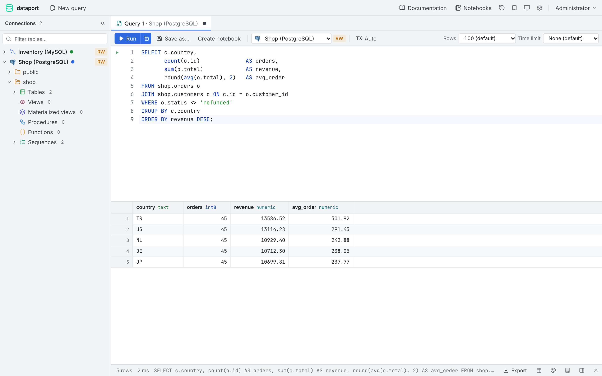
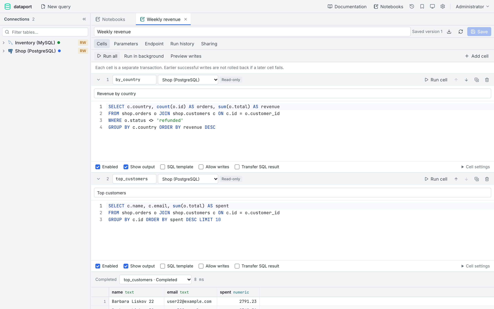
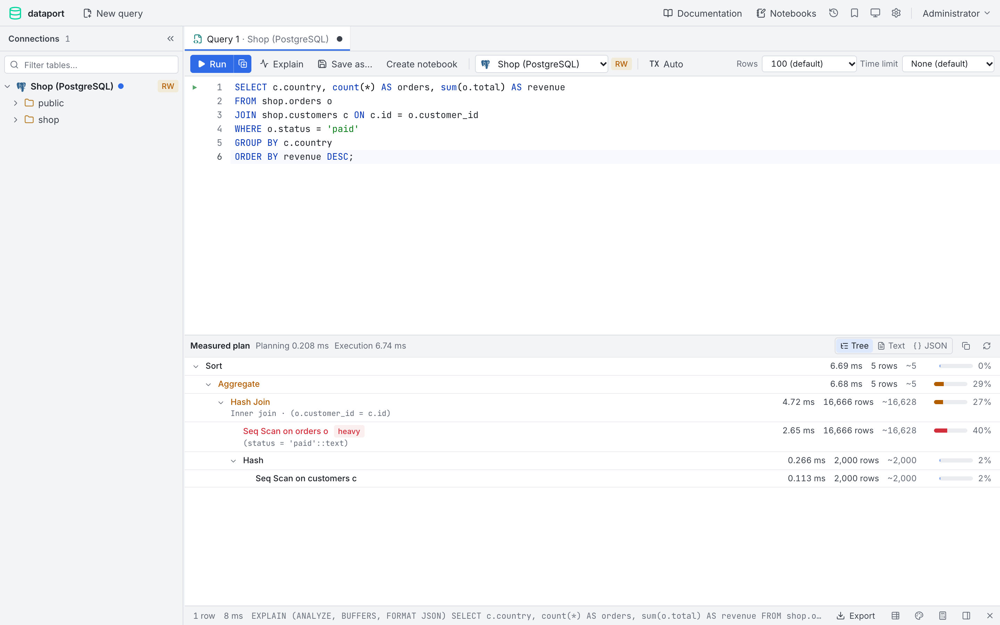
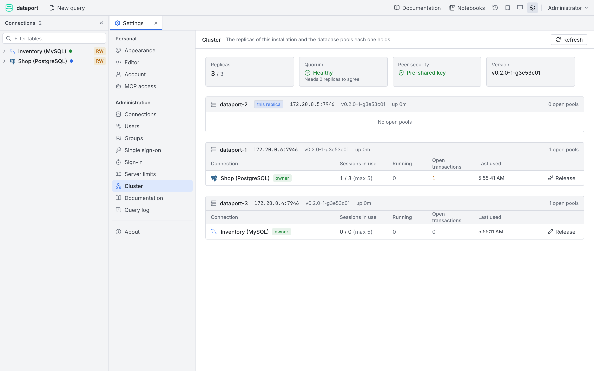
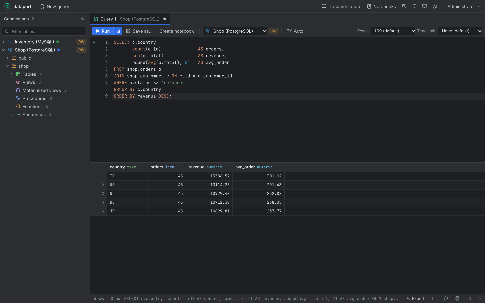

# dataport

[](https://raw.githubusercontent.com/rakunlabs/dataport/main/LICENSE)
[](https://sonarcloud.io/summary/overall?id=rakunlabs_dataport)
[](https://github.com/rakunlabs/dataport/actions)

A web SQL workspace for teams. One binary with the UI embedded. An admin
defines the databases and who may use them; users sign in and work only on
what was shared with them, without ever seeing hosts or passwords.



<table>
  <tr>
    <td width="50%"><br><sub>Notebooks</sub></td>
    <td width="50%"><br><sub>Execution plan (EXPLAIN ANALYZE)</sub></td>
  </tr>
  <tr>
    <td width="50%"><br><sub>Replicas and pool owners</sub></td>
    <td width="50%"><br><sub>Dark theme</sub></td>
  </tr>
</table>

## Features

- **Databases:** PostgreSQL, MySQL/MariaDB, SQL Server, Oracle, ClickHouse,
  Trino, SQLite, DuckDB and ODBC.
- **Access:** connections shared with users and groups, read-only or
  read-write. Production connections ask before every write. SSO (OIDC) with
  role and group sync.
- **Workspace:** SQL editor, editable result grid, schema
  browser, table structure and DDL, ER diagram, schema documentation, manual
  transactions, execution plans (EXPLAIN / ANALYZE with options), total row
  count, process list, export, import, copy between databases and test data
  generation.
- **Notebooks:** SQL cells that depend on each other, parameters and safe
  templates, background runs, and publishing as HTTP endpoints.
- **MCP:** AI agents work through the same access rules, read-only by default.
- **Replicas:** with the cluster on, each database pool is opened on one
  replica and the others forward their work to it. *Settings → Cluster* shows
  the replicas and the pools they own.

## Quick start

```sh
docker run -d -p 8080:8080 -v dataport:/data \
  -e DATAPORT_AUTH_ADMIN_PASSWORD=change-me \
  -e DATAPORT_AUTH_SECRET_KEY=a-long-secret \
  ghcr.io/rakunlabs/dataport:latest
```

Open http://localhost:8080 and sign in as `admin`. Add a database under
*Settings → Connections* and share it.

Keep `/data` (the SQLite store) and the secret key backed up: the key
encrypts the stored database passwords.

## Configuration

Configuration is loaded with [chu](https://github.com/rakunlabs/chu) in this
order, each source overriding the one before: defaults, a file, environment
variables. The file is `dataport.yaml` (or `.toml`, `.yml`, `.json`) in the
current folder or in `/etc`, or the path in `CONFIG_FILE`. Every key has an
environment variable with the `DATAPORT_` prefix, the path joined with `_`:
`store.dsn` is `DATAPORT_STORE_DSN`. Secrets may also come from Vault, Consul,
AWS, GCP or Azure; see chu's loaders.

```yaml
# dataport.yaml
log_level: info

server:
  port: "8080"
  base_path: ""                 # e.g. /dataport behind a proxy

store:
  type: postgres                # sqlite (default) or postgres
  dsn: postgres://dataport:secret@db:5432/dataport?sslmode=require
  # migrate_dsn: postgres://owner:secret@db:5432/dataport   # account that creates the tables

auth:
  secret_key: a-long-secret     # encrypts saved database passwords; same on every replica
  admin_username: admin
  admin_password: change-me     # first admin only; generated and logged when empty
  external_url: https://dataport.example.com   # for SSO redirects

query:
  file_dir: /files              # where SQLite and DuckDB files may be opened from

cluster:
  enabled: true
  dns_addr: dataport-headless   # resolves to every replica
  replicas: 3
  security_key: another-secret
```

Query, pool, notebook and MCP limits are not in the file: admins change them
under *Settings → Server limits*. Every key is listed in
[DETAILS.md](DETAILS.md#configuration).

## Several replicas

Use a PostgreSQL store and the same secret key everywhere, then join the
replicas:

```sh
DATAPORT_STORE_TYPE=postgres
DATAPORT_STORE_DSN='postgres://dataport:secret@db:5432/dataport'
DATAPORT_CLUSTER_ENABLED=true
DATAPORT_CLUSTER_DNS_ADDR=dataport-headless   # resolves to every replica
DATAPORT_CLUSTER_REPLICAS=3
DATAPORT_CLUSTER_SECURITY_KEY='…'
```

## Development

```sh
make env       # sample databases (docker compose)
make run       # API on :8080
make run-ui    # UI on :3000
make test
```

`make build-cluster && make env PROFILE=cluster` runs three replicas on
:8081–8083.

## Documentation

[DETAILS.md](DETAILS.md) covers everything else:
[configuration](DETAILS.md#configuration),
[replicas and cluster](DETAILS.md#replicas-and-cluster),
[access](DETAILS.md#how-access-works),
[workspace](DETAILS.md#workspace),
[notebooks and endpoints](DETAILS.md#notebooks-and-sql-endpoints),
[single sign-on](DETAILS.md#single-sign-on),
[supported databases](DETAILS.md#supported-databases) and
[MCP](DETAILS.md#mcp).
